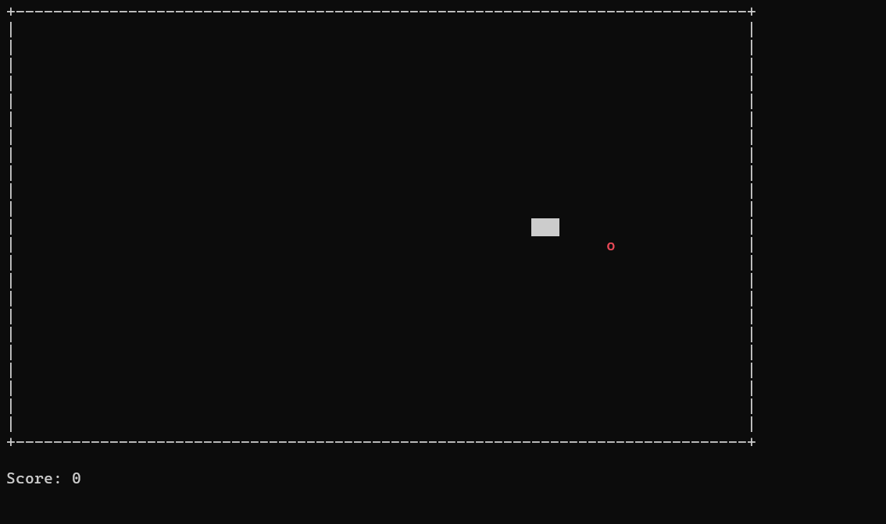

# Заметки: WSL, OpenCode и нейросети

> Без сложных слов. А которые будут, я сразу объясню. Возможно сказанное мною будет отличаться от общепринятых норм, будет неправильным по теории. Но это практика. Это то, что поможет разобраться с этим и работать.

## Введение

Использование непонятно чего, чтобы создавать непонятно что порождает концентрацию неизвестности вокруг тебя. Поэтому сначала изучение.

ИИ не существует. Нейросеть большая статистическая машина.

Есть известный эффект, который называют “эффектом ИИ” или “парадоксом Теслера”.

Как только задача решена, её перестают называть ИИ.

- OCR — раньше «ИИ», теперь «просто распознавание».
- Шахматный движок — раньше «ИИ», теперь «поиск с альфа-бета отсечением».
- Маршрутизация в Google Maps — раньше «ИИ», теперь «графовый алгоритм».
- LLM — сейчас «ИИ», через 10 лет, возможно, будут «просто языковыми моделями».

Нейросеть не умеет думать, не умеет сочинять, не умеет делать что-то случайно (выбрать число, например. За исключением семплера). Всегда есть паттерн, всегда есть закономерность. Она лишь статистически вычисляет наиболее вероятный следующий символ.

Нейросеть - Архитектура + веса + данные, лосс.

Модель - это не нейросеть, а лишь её зафиксированное состояние в определенный момент времени. Только архитектура и веса.

Нейросеть развивается, модель - нет.

**Наша цель:**

- Поставить WSL
- Поставить Ubuntu
- Поставить Харнесс (OpenCode)
- Подключиться к модели
- Наколдовать код

Харнесс - Это то, что работает во время выполнения. Он управляет диспетчеризацией инструментов, следит за лимитами, предотвращает зацикливание и проверяет результат.

- Оркестрация и контроль цикла (Loop Control)
- Управление контекстом и памятью (Context & Memory)
- Строгие ограничители и безопасность (Guardrails)
- Верификация и рабочие процессы (Workflows & Verification)
- Самодостраивание (Self-extension)

## Установка(включение) WSL + дистрибутива Linux

Требования:

- Windows 2H22 + процессор с AVX2.
- Если нет AVX2, то OpenCode не установится.
- Без 2H22 можно вне WSL, но результат может быть хуже.

```
dism.exe /online /enable-feature /featurename:Microsoft-Windows-Subsystem-Linux /all /norestart
dism.exe /online /enable-feature /featurename:VirtualMachinePlatform /all /norestart
wsl --install -d Ubuntu
```


Прописываем имя пользователя/пароль (пароль нужен будет для sudo). Далее отвечаем на вопросы в терминале, после чего считаем, что линукс у нас установлен. Можно будет поиграть с настройками безопасности, правами и т.д..


Переходим в корень диска С, создаем в нем папку. В ней будем работать.

```
mkdir <folderName>
```


## Установка openCode

```
curl -fsSL https://opencode.ai/install | bash
```


Для дальнейшей работы потребуется перезапуск дистрибутива.

```
wsl --shutdown
wsl -d Ubuntu
```

Для корректного запуска openCode необходимо сначала создать проект.

Переходим в Visual Studio, создаем консольное приложение. Местом создания выбираем c:/ubuntu_wsl/projects

Далее -> Создать


Очень много фишек харнессов (агентов) завязаны на взаимодействие с гитом. Запросы/оценка изменений, просмотр истории, автоматическая фиксация (зло) и еще многое-многое. Если не установлен гит, то переходим к следующему пункту.

Добавляем проект в гит(гитхаб).


### Итог.

Переходим в проект в WSL и прописываем opencode.

Подсказка нам сразу говорит про следующий шаг. Прописываем

```
/connect
```


Модели делятся на несколько видов в зависимости от стандарта апи. Выбираем способ связи с моделями (по сути шлюз запросов). Оставляем рекомендуемое OpenCode Zen. Это разработка самого OpenCode. Откроется окно ввода API key.

Переходим на сайт opencode.ai/auth и регистрируемся. Затем переходим на страницу Account в выпадающем меню учетной записи. Добавляем новый персональный ключ API.


Вводим только название и переходим дальше. Откроется окно с токеном, который надо скопировать. Не закрывайте окно, пока не подключитесь к модели.


Возвращаемся в opencode, в поле API key вводим скопированный ключ (shift + ins), нажимаем enter.

После ввода ключа должно появиться окно выбора модели, которую мы будем использовать. Тут всё на усмотрение и бюджет. Рекомендую Big Pickle для знакомства с разработкой с использованием нейросетей. Big Pickle это анонимная модель, которая фактически меняется время от времени. Пользователи неоднократно вычисляли, кто под капотом. Там были и glm, и DeepSeek.


Бесплатные модели часто погибают, выходят из бесплатной версии, имеют серьезные ограничения и т. д. Для смены модели в любой момент можно прописать /models и выбрать другую модель из списка.

Все системные вызовы делаются через /

- /models
- /sessions
- /clear
- /compact

Сами команды во всех харнессах примерно одинаковые и работают примерно одинаково.

Попросим нейронку изучить наш проект. (Напомню, что мы находимся в папке проекта). Так и пишем “Изучи проект”. Сразу поменяется экран взаимодействия. После того, как нейронка подумает, хочу обратить внимание на несколько вещей.


Большой блок - полезный ответ. Это её финальное решение.

Маленький блок - это как раз фичи взаимодействия с гитом. Нейронка попросила информацию о проекте, увидела коммиты и т.д.

Верхняя стрелочка - это сессия - контейнер состояния. Внутри сессии живет “память” (контекст) о текущем диалоге. Если пришлось завершить работу, а потом по какой-то причине понадобилось вернуться в этот диалог, то это можно сделать, восстановив сессию.

```
/sessions
```

Затем выбираем нужную сессию.


Нижняя стрелочка - контекст. Это не знания и не память, как это говорят. Технически, это информация, которая передается вместе с каждым запросом. По мере взаимодействия с моделью контекст будет расти. Больше контекст - больше расход токенов.

## Взаимодействие с openCode из коробки

Нейронка просмотрела наш код, сделала какой-то вердикт. Перед тем, как мы начнем делать всякие ужасы с помощью нейросети, нам надо её обучить нашим манерам, поведению, стилю кода и т. д.

Что мы можем получить, если не настроим:

- Автокоммиты
- Отсутствие код стайла
- Превышение полномочий
- Шаманство с файлами
- Игнорирование инструкций

Недостроенный гигачат умудрился завязать проект в узел. Единственным решением было откатить изменения на момент до его внедрения.

### Настройка глобальных правил:

- Переходим в гит, файл mds/instruction.md ([Ссылка](https://github.com/Basliney/openCodeTutorial/blob/main/mds/instruction.md?plain=1))
- Открываем файл instructions.md
- Копируем текст
- Вставляем скопированный текст в OpenCode
- Перезапускаем OpenCode

После этих манипуляций у OpenCode появятся ряд логичных для нас ограничений, но нелогичных для нейронки, которые прописаны в файле. Можно постоянно их достраивать и улучшать.

### СабАгенты

- Переходим в гит, файл mds/agents.md ([Ссылка](https://github.com/Basliney/openCodeTutorial/blob/main/mds/agents.md?plain=1))
- Открываем файл agents.md
- Копируем текст
- Вставляем скопированный текст в OpenCode
- Перезапускаем OpenCode

После выполнения этой задачи, в OpenCode появится 1 Primary-агент и 3 саб-агента. Это значит, что тимлида можно выбрать для решения всех задач, а он уже будет делегировать подзадачи саб агентам.

1. Запускаем тимлида: вводим /agents (или Tab для переключения агентов) → выбираем teamlead.
2. Даём задачу обычным сообщением, например: «Разработай модуль X». Тимлид сам разобьёт её: Аналитик сделает бизнес-план → Тимлид план доработки → Кодер напишет код → Тестер проверит тестами/качеством, и вернёт сводку.

Прямой вызов суб-агента (без тимлида) тоже возможен — coder, tester, analyst выбираются через @. Но для командной работы основная цепочка через teamlead.

Работа через агентов всегда дольше, тратит больше токенов. Поэтому для экономии лучше не все задачи поручать тимлиду.

## Работа с инструкциями

Харнессы очень любят структурированные .md файлы. Поэтому любая задача выполнится лучше, если она будет передана в формате .md (для этого мы ставили саб-агентов). Конечно, это не панацея, но шаг к лучшему. Если неправильные требования будут красиво оформлены, они все равно будут исполнены неправильно.

Есть много очевидных правил, фишек, норм, которые очевидны для человека, о которых он даже не думает. Их надо рассказать нейронке в постановке задачи / системных инструкциях, иначе есть риск потерять эти тонкости.

При больших задачах сначала делаем план в виде .md файла, читаем, анализируем, а потом выполняем.

Во время работы может появиться необходимость дать нейронке файл, чтобы она его изучила, опиралась на него во время выполнения и т. д. Не прикреплять много файлов. Это всегда приводит к раздуванию контекста, более долгой и дорогой обработке. Всё что будет нужно, нейронка с харнессом возьмут сами (если, конечно, не стоят ограничения на такие действия).

## Практика

На текущий момент мы имеем:

- Созданный пустой проект Snake
- Установленные WSL, OpenCode
- Работающую модель под управлением OpenCode

На всякий случай чистим сессию, чтобы не подтянуть в неё какую-то ненужную информацию (если видим стартовый экран OpenCode, то ничего чистить не надо, сессия и так новая).

```
/new (либо /clear)
```

На протяжение всей работы харнесс может запросить доступы к чтению/изменению файлов, запуску команд. Нейронка остановится до получения доступа, либо отказа. Отказ может полностью остановить работу, если не будет найдено альтернативное решение, а также спровоцировать на поиск этого решения, что потратит еще больше токенов

### Пишем змейку в консоли



- Переходим в гит, файл mds/snake.md ([Ссылка](https://github.com/Basliney/openCodeTutorial/blob/main/mds/snake.md?plain=1))
- Копируем текст
- Вставляем скопированный текст в OpenCode
- Ждем
- Запускаем либо играем в уже запущенную
- (опционально) можно попросить нейронку что-то переделать в игре

Если мы хотим сделать препятствия, уровни, какие-то глобальные изменения, то делаем через тимлида. В остальном же можно спокойно использовать Build режим.

### Простейший сайт-визитка

Выходим из OpenCode, создаем папку, переходим в папку, открываем opencode

```
Ctrl + c
cd ../
mkdir visit
cd visit
opencode
```

Создание визитки из шаблона. **Внимание это будет долго (20-50 минут)**

- Переходим в гит, файл mds/visit.md ([Ссылка](https://github.com/Basliney/openCodeTutorial/blob/main/mds/visit.md?plain=1))
- Копируем текст
- Переходим в OpenCode, переходим на тимлида (tab)
- Вставляем скопированный текст в OpenCode (перед вставкой напишите любимый цвет)
- Ждем (долго)
- Запускаем файл через браузер (лучше хром)
- (опционально) можно попросить нейронку что-то переделать в сайте

Дальше всё ограничивается только вашей фантазией. Можно просить добавить реальную вашу информацию, фото, ссылки, менять блоки, добавлять фишки, построить на этой основе большую систему заказа проектов. Можно менять код руками (не одновременно с нейронкой, иначе могут быть конфликты).

Пример выполненного подобного сайта за 2 вечера (3-4 часа) https://basliney.github.io/

## Реальные кейсы

Фича - переход на другую интеграцию

- Расход токенов при полной настройке ограничений, саб агентов, правил, норм ЯП, командных требований, требований компании примерно **150млн токенов** на среднюю фичу (glm)
- Время чистой работы нейронки около 12 часов
- После выполнения фичи необходимо сгенерировать документацию для коллег

Дебаг - поиск ошибки по коду

- При грамотной постановке задачи дебаг + фикс не займет больше **15млн токенов**
- Обязательно фиксация в юнит тестах, фиксация в документации
