# Заметки: WSL, OpenCode и нейросети

> Без сложных слов. А которые будут, я сразу объясню. Возможно сказанное мною будет отличаться от общепринятых норм, будет неправильным по теории. Но это практика. Это то, что поможет разобраться с этим и работать.

## Что такое ИИ

Использование непонятно чего, чтобы создавать непонятно что порождает концентрацию неизвестности вокруг тебя. Поэтому сначала изучение.

> **ИИ не существует. Нейросеть — это большая статистическая машина.**

Есть известный эффект, который называют *«эффектом ИИ»* или *«парадоксом Теслера»*:

Как только задача решена, её перестают называть ИИ.

- OCR — раньше «ИИ», теперь «просто распознавание».
- Шахматный движок — раньше «ИИ», теперь «поиск с альфа-бета отсечением».
- Маршрутизация в Google Maps — раньше «ИИ», теперь «графовый алгоритм».
- LLM — сейчас «ИИ», через 10 лет, возможно, будут «просто языковыми моделями».

Нейросеть не умеет думать, не умеет сочинять, не умеет делать что-то случайно (выбрать число, например; за исключением семплера). Всегда есть паттерн, всегда есть закономерность. Она лишь статистически вычисляет наиболее вероятный следующий символ.

### Основные понятия

- **Нейросеть** — Архитектура + веса + данные, лосс.
- **Модель** — это не нейросеть, а лишь её зафиксированное состояние в определённый момент времени. Только архитектура и веса.
- Нейросеть развивается, модель — нет.

## Наша цель

1. Поставить WSL
2. Поставить Ubuntu
3. Поставить Харнесс (OpenCode)
4. Подключиться к модели
5. Наколдовать код

## Харнесс (OpenCode)

**Харнесс** — это то, что работает во время выполнения. Он управляет диспетчеризацией инструментов, следит за лимитами, предотвращает зацикливание и проверяет результат.

- Оркестрация и контроль цикла (Loop Control)
- Управление контекстом и памятью (Context & Memory)
- Строгие ограничители и безопасность (Guardrails)
- Верификация и рабочие процессы (Workflows & Verification)
- Самодостраивание (Self-extension)

## Установка (включение) WSL + дистрибутива Linux

Выполняем команды в **PowerShell от имени администратора**:

```powershell
dism.exe /online /enable-feature /featurename:Microsoft-Windows-Subsystem-Linux /all /norestart
dism.exe /online /enable-feature /featurename:VirtualMachinePlatform /all /norestart
wsl --install -d Ubuntu
```

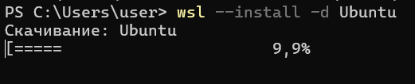


1. Прописываем имя пользователя/пароль (пароль нужен будет для `sudo`).
2. Отвечаем на вопросы в терминале — после чего считаем, что линукс у нас установлен.
3. Можно будет поиграть с настройками безопасности, правами и т.д.
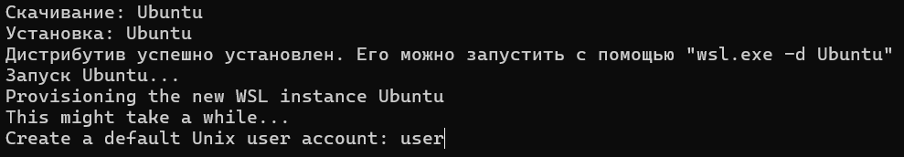

Переходим в корень диска **C:**, создаём в нём папку. В ней будем работать:

```bash
mkdir <folderName>
```

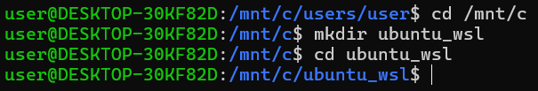

## Установка OpenCode

```bash
curl -fsSL https://opencode.ai/install | bash
```

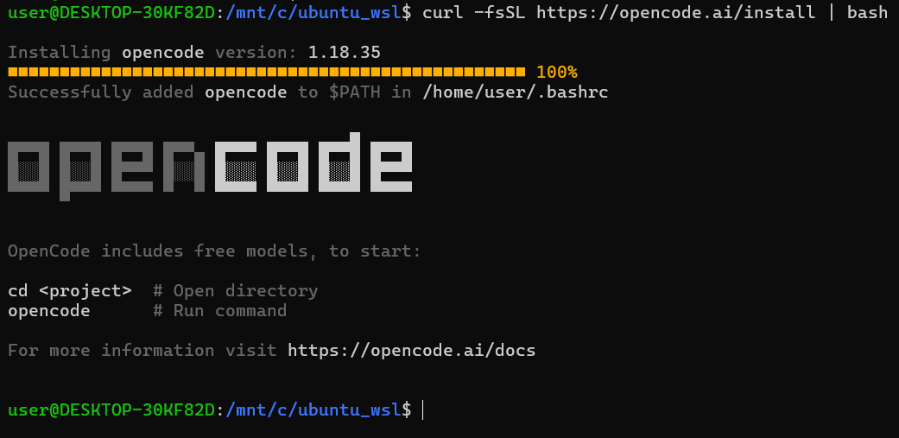

Для дальнейшей работы потребуется перезапуск дистрибутива:

```bash
wsl -d Ubuntu
```

### Создание проекта

Для корректного запуска openCode необходимо сначала создать проект:

1. Переходим в **Visual Studio**.
2. Создаём консольное приложение.
3. Местом создания выбираем `C:/ubuntu_wsl/projects`.
4. Нажимаем **Далее** -> **Создать**.

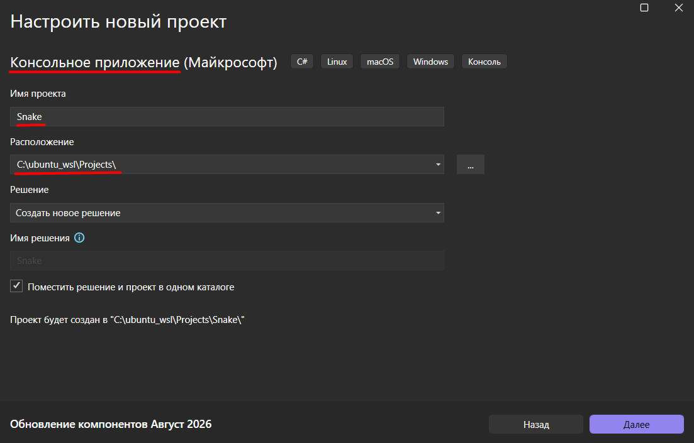

## Гит

Очень много фишек харнессов завязаны на взаимодействие с гитом: запросы/оценка изменений, просмотр истории, автоматическая фиксация (зло) и ещё многое-многое. Если не установлен гит, то переходим к следующему пункту.

> **Добавляем проект в гит (гитхаб).**

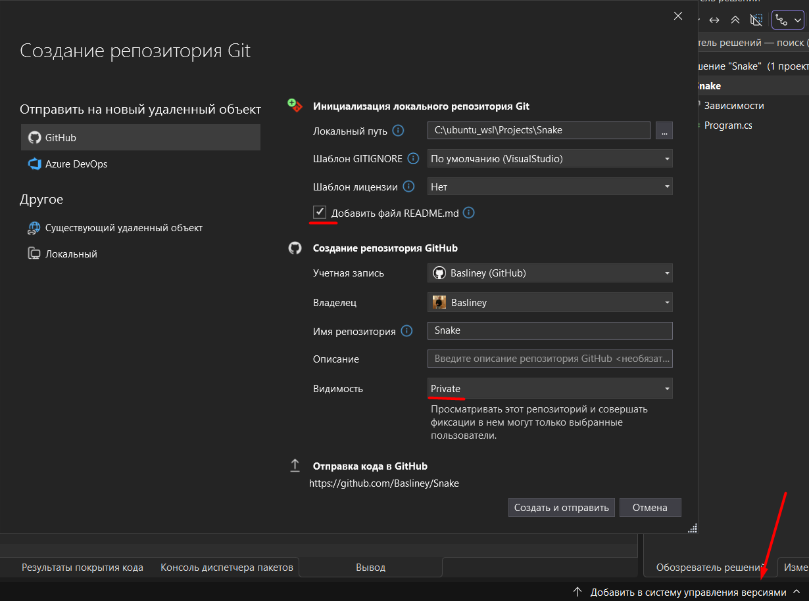
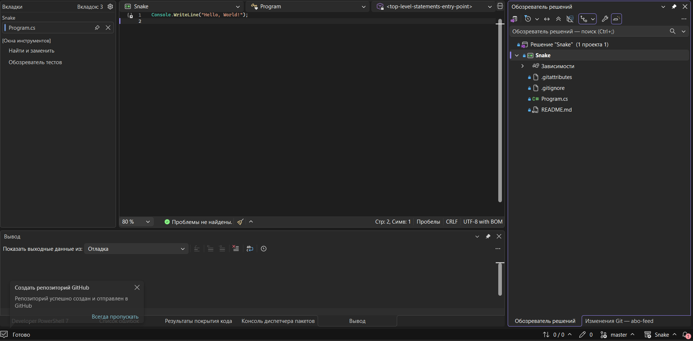

## Подключение к модели

1. Переходим в проект в WSL и прописываем `opencode`.
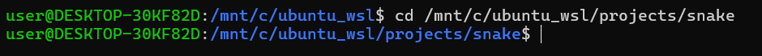
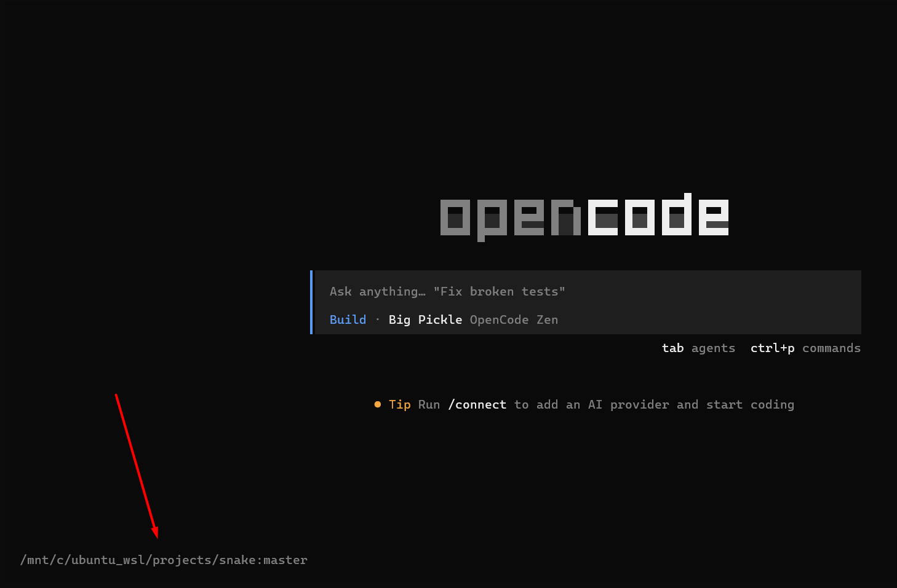

2. Подсказка нам сразу говорит про следующий шаг — прописываем:

```
/connect
```

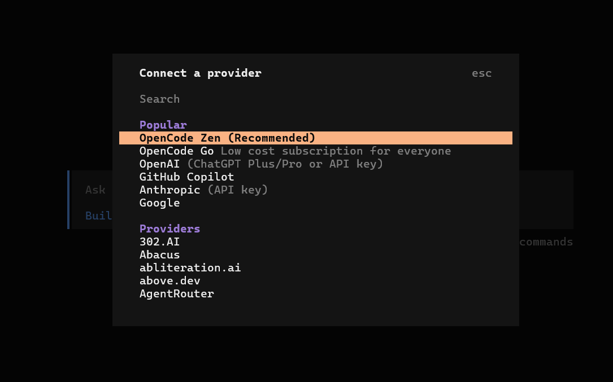

Модели делятся на несколько видов в зависимости от стандарта API. Выбираем способ связи с моделями (по сути шлюз запросов). Оставляем рекомендуемое **OpenCode Zen** — это разработка самого OpenCode. Откроется окно ввода API key.

1. Переходим на сайт [opencode.ai/auth](https://opencode.ai/auth) и регистрируемся.
2. Переходим на вкладку **Keys**.
3. Добавляем новую сервисную УЗ. 
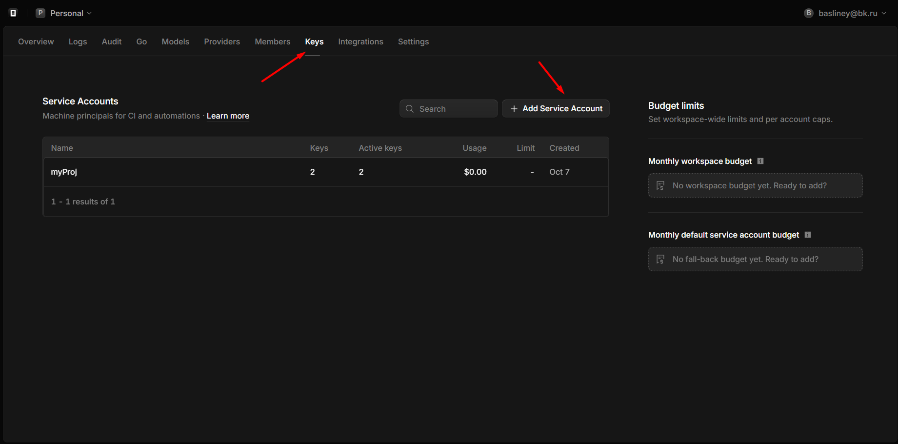
4. Вводим только название и переходим дальше — откроется окно с токеном, который надо скопировать.
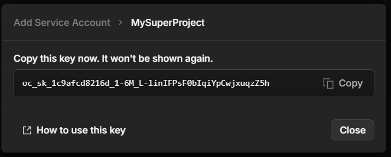
5. Возвращаемся в opencode, в поле **API key** вводим скопированный ключ (`shift + ins`), нажимаем **Enter**.

После ввода ключа должно появиться окно выбора модели, которую мы будем использовать. Тут всё на усмотрение и бюджет. Рекомендую **Big Pickle** для знакомства с разработкой с использованием нейросетей.

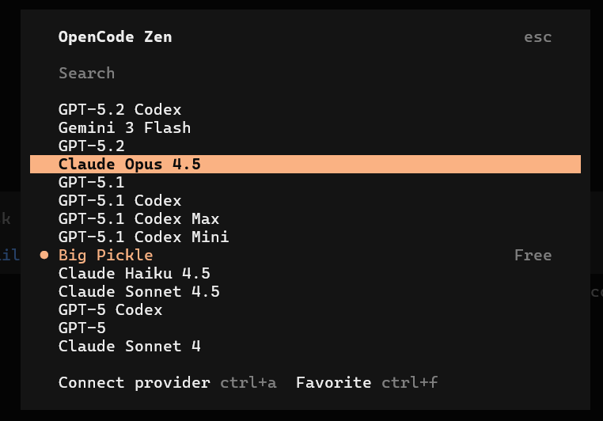

> Бесплатные модели часто погибают, выходят из бесплатной версии, имеют серьёзные ограничения и т.д. Для смены модели в любой момент можно прописать `/models` и выбрать другую модель.

## Системные команды

Все системные вызовы делаются через `/`:

- `/models`
- `/sessions`
- `/clear`
- `/compact`

Сами команды во всех харнессах примерно одинаковые и работают примерно одинаково.

## Изучение проекта нейросетью

Попросим нейронку изучить наш проект (напомню, что мы находимся в папке проекта). Так и пишем: *«Изучи проект»*. Сразу поменяется экран взаимодействия. После того, как нейронка подумает, обратим внимание на несколько вещей.

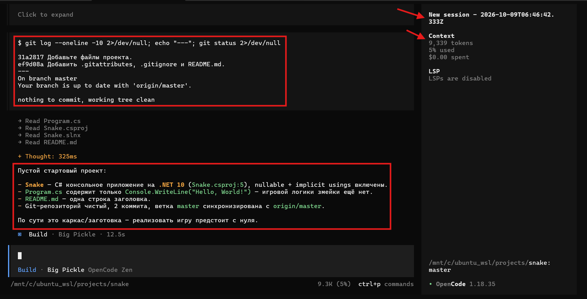

- **Большой блок** — полезный ответ. Это её финальное решение.
- **Маленький блок** — это как раз фичи взаимодействия с гитом. Нейронка попросила информацию о проекте, увидела коммиты и т.д.
- **Верхняя стрелочка** — это сессия, контейнер состояния. Внутри сессии живёт «память» (контекст) о текущем диалоге. Если пришлось завершить работу, а потом по какой-то причине понадобилось вернуться в этот диалог, то это можно сделать, восстановив сессию:
  ```
  /sessions
  ```
  Затем выбираем нужную сессию.
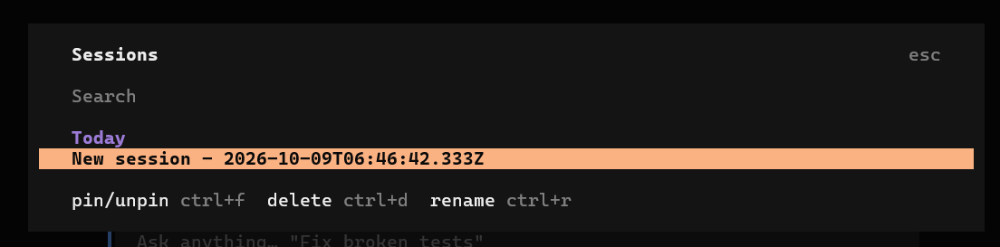
- **Нижняя стрелочка** — контекст. Это не знания и не память, как это говорят. Технически — это информация, которая передаётся вместе с каждым запросом. По мере взаимодействия с моделью контекст будет расти. Больше контекст — больше расход токенов.

## Работа с инструкциями (взаимодействие «из коробки»)

> Нейронка просмотрела наш код, сделала какой-то вердикт. Перед тем, как мы начнём делать всякие ужасы с помощью нейросети, нам надо её обучить нашим манерам, поведению, стилю кода и т.д.

Что мы можем получить, если не настроим:

- Автокоммиты
- Отсутствие код стайла
- Превышение полномочий
- Шаманство с файлами
- Игнорирование инструкций

Харнессы очень любят `.md` файлы. Поэтому любая задача выполнится лучше, если она будет передана в формате `.md`. Конечно, это не панацея, но шаг к лучшему.

- При больших задачах сначала делаем план в виде `.md` файла, а потом выполняем.
- Не прикреплять много файлов (на всякий случай).

## Осталось

- Агенты.
- Реальные кейсы.
- Накопление ошибки.
